<p>
<a href="https://runplexus.com">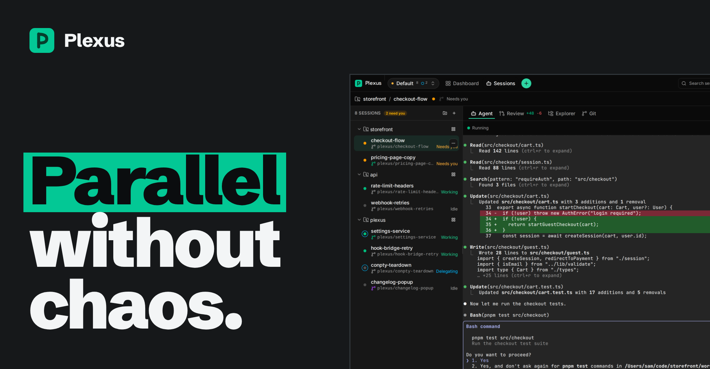</a>
<a href="#working">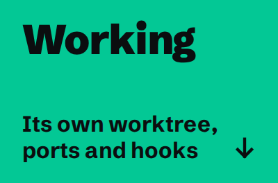</a><a href="#needs-you"></a><a href="#delegating">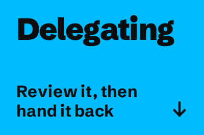</a><a href="#merged">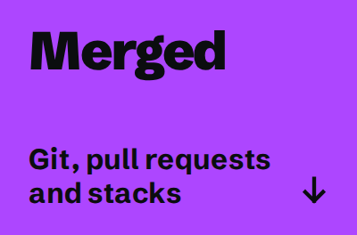</a><a href="#idle">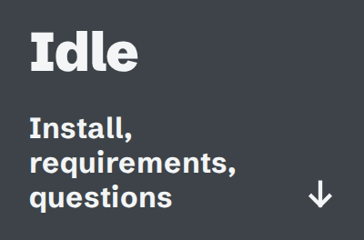</a>
</p>

<sub>Demo: the real Plexus window, running simulated sessions. Each colour is a state a session can be in, and a chapter below.</sub>

**Plexus runs many Claude Code sessions side by side, each in its own git worktree, and shows you which one is working, which is idle and which one needs you.**

It is a desktop app for macOS, Windows and Linux. It drives the `claude` CLI you already use, on your own subscription: no API key, and your code stays on your machine.

<p>
<a href="https://app.runplexus.com/go/download/mac-arm"></a><a href="https://app.runplexus.com/go/download/win"></a><a href="https://app.runplexus.com/go/download/deb">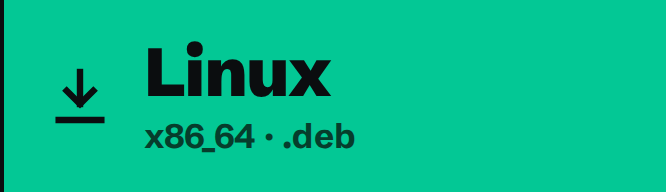</a>
</p>

Also: [macOS for Intel](https://app.runplexus.com/go/download/mac-x64) · [AppImage](https://app.runplexus.com/go/download/appimage) · [every build on the Releases page](https://github.com/CodedWords/plexus-releases/releases/latest). Plexus updates itself after the first install. You need [Claude Code](https://code.claude.com/docs/en/setup) and Git.

[Website](https://runplexus.com) · [Documentation](https://runplexus.com/docs) · [Changelog](https://runplexus.com/changelog) · [How it compares](https://runplexus.com/compare/claude-code)

<br>

<h2 id="working"><a href="#working">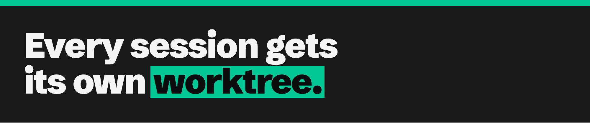</a></h2>

Start a session and Plexus creates a git worktree for it, on a new `plexus/<name>` branch off the base you pick, or on a branch that already exists. Five agents can work in one repository without writing over each other, and your main checkout stays where it is.

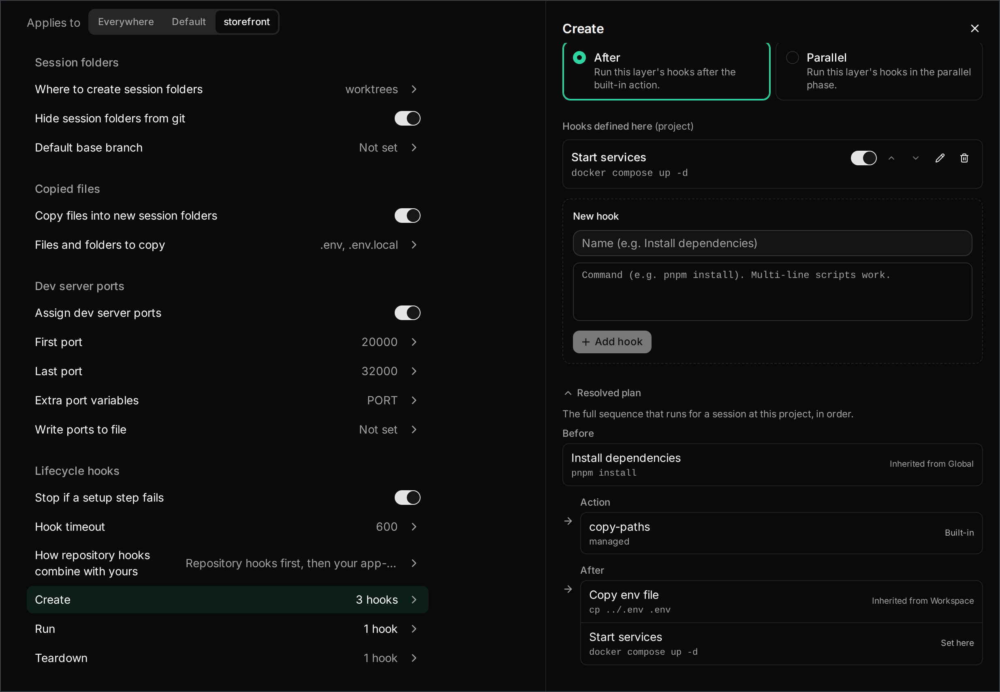

<sub>Settings → Worktrees & hooks for the project <i>storefront</i>: the files copied into each worktree, its ports, and the resolved plan of what runs when one is created.</sub>

- **The real Claude Code.** Each session runs the `claude` CLI you already have, signed in as you. Plexus does not bundle an agent of its own and never asks for an API key.
- **Workspace, project, session.** One sidebar tree for every repository you work in. Settings and hooks cascade down it, so a default you set once covers a whole group of repositories.
- **The files git leaves out.** `.env` and `.env.local` are copied into every new worktree, so the dev server starts there too.
- **Ten ports for each session.** A block of free localhost ports, as `PLEXUS_PORT`, `PLEXUS_PORT_1` to `PLEXUS_PORT_9` and `PORT`, so two checkouts of one app never fight over port 3000.
- **Hooks at three levels.** Create, Run and Teardown scripts, set globally, per workspace or per project, and resolved into one plan you can read before a session starts.

Hooks can also ship with the repository. Commit them to `.plexus/hooks.json` and everyone who adds it gets the same setup:

```json
{
  "create": [{ "name": "Install dependencies", "command": "pnpm install" }],
  "run": [{ "name": "Start services", "command": "docker compose up -d" }],
  "teardown": [{ "name": "Stop services", "command": "docker compose down" }]
}
```

In the docs: [Sessions](https://runplexus.com/docs/sessions) · [Worktrees](https://runplexus.com/docs/worktrees) · [Hooks](https://runplexus.com/docs/hooks)

<br>

<h2 id="needs-you"><a href="#needs-you"></a></h2>

A dot on every session follows Claude Code's own lifecycle events. It is green while the agent works, and amber when it is your turn: a permission prompt, a question, a plan to approve, or a finished turn. Grey means nothing is in flight.

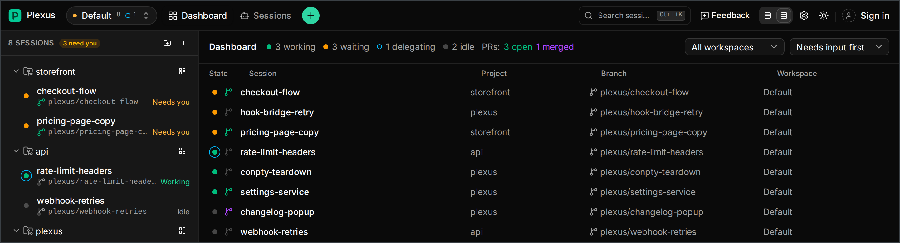

<sub>The dashboard: every session from every workspace, the ones waiting on you first, with each branch's pull request.</sub>

- **Told when it is your turn.** A native notification names the session and what it needs, even with the window minimised.
- **One table for everything.** <kbd>⌘</kbd> <kbd>0</kbd> opens the dashboard, with every session's state, project, branch and pull request, and a count of what is working, waiting and idle.
- **Any session in a keystroke.** <kbd>⌘</kbd> <kbd>K</kbd> finds a session by its name, branch, project or workspace.
- **Side by side.** A split view puts up to six sessions of one project next to each other, and a session, project or terminal can open in a window of its own.
- **Stop, and pick it up later.** Stopping a session ends the agent and keeps the worktree, the branch and the conversation. Resume reattaches the same conversation, even after you quit Plexus.

<sub>On Windows and Linux, <kbd>Ctrl</kbd> takes the place of <kbd>⌘</kbd>.</sub>

In the docs: [Status](https://runplexus.com/docs/status) · [Dashboard](https://runplexus.com/docs/dashboard) · [Split view](https://runplexus.com/docs/split-view) · [Shortcuts](https://runplexus.com/docs/shortcuts)

<br>

<h2 id="delegating"><a href="#delegating"></a></h2>

The Review tab compares a session's worktree with its base branch, file by file, before anything is pushed. Comment on a line, then send your comments to the agent, which picks them up on its next turn.

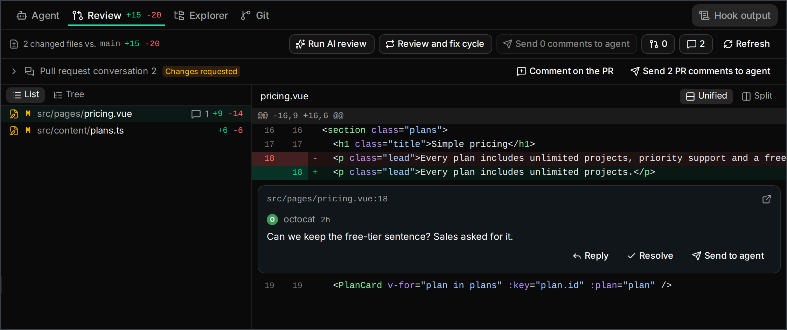

<sub>Review for <i>pricing-page-copy</i>: the pull request's review thread sits on the line it is about, and Send to agent hands it over.</sub>

- **AI review on demand.** A separate, headless Claude reads the diff and leaves its findings as inline comments, following review instructions you write.
- **Review and fix, unattended.** The cycle reviews, has a separate agent apply the fixes, and reviews again, until a review finds nothing or it reaches the round limit. It never pushes.
- **The pull request conversation, in place.** On GitHub and Bitbucket, review threads appear under the lines they are about. Reply, resolve, or send them to the agent.
- **Delegation you can see.** When an agent hands work to background subagents, a blue ring appears around its dot, and a session whose agent is free while that work runs reads Delegating.
- **A colleague's branch, too.** Start a session on any existing branch and review it the same way, in a worktree of its own.

In the docs: [Review](https://runplexus.com/docs/review) · [Pull requests](https://runplexus.com/docs/pull-requests) · [Status](https://runplexus.com/docs/status)

<br>

<h2 id="merged"><a href="#merged">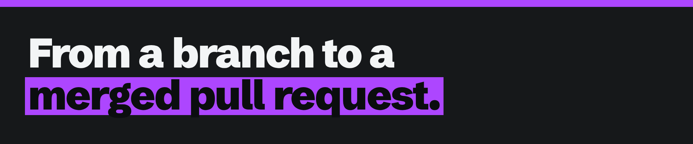</a></h2>

Every session has a Git tab, and every project has a full git client: the commit graph with every session's branch, Pull, Push and Stash, and pull requests on GitHub and Bitbucket. You can watch `plexus/<name>` branches leave `main` and come back through their pull requests.

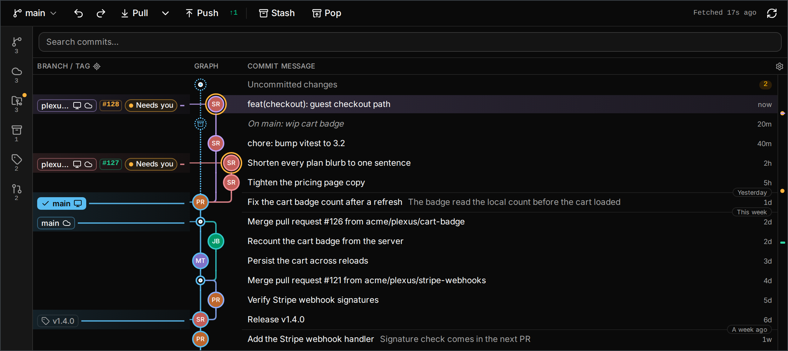

<sub>The Git tab of the project <i>storefront</i>: each session's branch tip shows what its agent is doing.</sub>

- **A git client for each session.** The branch's commits since its base, staging with discard and stash, an AI-drafted commit message, and Push, which is never a force-push. Rebase, merge the base in, or squash.
- **Pull requests without the `gh` CLI.** Create PR pushes the branch and opens the pull request, with an optional AI-drafted description. The branch icon turns green while it is open and purple once it is merged, and shows CI status.
- **Stacked pull requests.** Start a session on top of another session's branch. Plexus restacks the branches while the agents work, retargets the pull requests when one merges, and lands the stack in order. *Paid plan.*
- **Your issues, next to the agents.** GitHub issues, GitHub Projects boards and Plnnrly work items open in the project, and any of them can start a session. *Paid plan.*

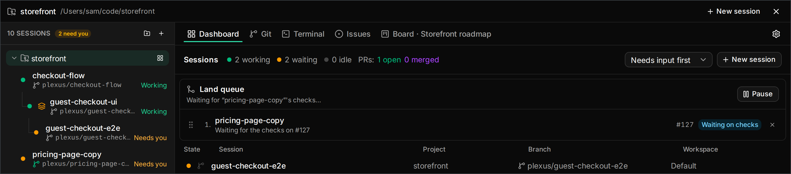

<sub>Two sessions stacked on <i>checkout-flow</i>, and the land queue waiting on the checks for #127.</sub>

In the docs: [Git](https://runplexus.com/docs/git) · [Pull requests](https://runplexus.com/docs/pull-requests) · [Stacks](https://runplexus.com/docs/stacks) · [Issues](https://runplexus.com/docs/issues)

<br>

<h2 id="idle"><a href="#idle"></a></h2>

Download the build for your system and install it like any other app. It keeps itself up to date after that, and shows what changed the first time you open a new version.

| System | Download | Install |
| :-- | :-- | :-- |
| **macOS** | [Apple Silicon](https://app.runplexus.com/go/download/mac-arm)<br>[Intel](https://app.runplexus.com/go/download/mac-x64) | Open the `.dmg` and drag Plexus into Applications. |
| **Windows** | [x64 installer](https://app.runplexus.com/go/download/win) | The `-setup.exe` installs for your user, so you don't need administrator rights. |
| **Linux** | [`.deb`](https://app.runplexus.com/go/download/deb)<br>[AppImage](https://app.runplexus.com/go/download/appimage) | x86_64. `sudo apt install ./Plexus_<version>_amd64.deb`, or `chmod +x` the AppImage and run it. |

[](https://github.com/CodedWords/plexus-releases/releases/latest) &nbsp;Every build, including the per-machine `.msi` for Windows, is on the [Releases page](https://github.com/CodedWords/plexus-releases/releases).

<sub>The download links go through a counter on runplexus.com that adds one to an anonymous total and forwards you to the file on this repository's latest release. No account, no personal data, no cookies.</sub>

**What you need**

- **Claude Code**, with `claude --help` working in a terminal. Plexus hands your existing sign-in to every session.
- **Git** on your `PATH`.
- *Optional:* a GitHub or Bitbucket connection for pull requests, made with a one-click sign-in in Settings. On Linux, `notify-send` for desktop notifications.

**Free, and what a plan adds.** The core of Plexus is free: sessions, worktrees, review, the git client, hooks, pull requests and the dashboard all work without an account. A paid plan adds things on top, such as cross-device sync, prompts saved to your account, organization features, the Issues and Board tabs, and stacked pull requests with a land queue. [See the plans](https://runplexus.com/pricing).

<details>
<summary><b>Do I need an API key?</b></summary>
<br>

No. Plexus wraps the real `claude` CLI and hands your existing Claude Code sign-in to each session, so the agents run on your own subscription.

</details>

<details>
<summary><b>Does my code leave my machine?</b></summary>
<br>

No. Your code, files, repositories, terminal sessions, and the prompts and output you exchange with agents stay on your device. Pull request features talk to GitHub or Bitbucket directly from your machine, with the account you connect.

</details>

<details>
<summary><b>What does Plexus send?</b></summary>
<br>

One anonymous usage message a day: operating system, processor type, app version, a random install identifier that is hashed under a key that changes daily, how much each feature was used since the last message, and coarse settings such as theme, model and project counts as a range. Never code, prompts, paths, repository or branch names.

Set `DO_NOT_TRACK` or `PLEXUS_NO_TELEMETRY` before launching and it sends nothing. The details are in the [Privacy Policy](https://runplexus.com/legal/privacy).

</details>

<details>
<summary><b>Does it work with agents other than Claude Code?</b></summary>
<br>

Not today. Plexus is built Claude-first, and Claude Code is the only agent it runs. Other coding CLIs are meant to plug in behind the same seam later.

</details>

<details>
<summary><b>Do I need a Plexus account?</b></summary>
<br>

No. Sessions, worktrees, review, the git client, hooks, pull requests and the dashboard work without signing in. An account is optional, and only needed for things like cross-device sync.

</details>

<details>
<summary><b>Is Plexus open source?</b></summary>
<br>

No. Plexus is proprietary software. It is free to download, and its core is free to use. This repository publishes the builds and the update feed the app reads; it holds no source code.

</details>

<details>
<summary><b>I found a bug. Where do I report it?</b></summary>
<br>

Click **Feedback** in the app bar. It sends your report straight to the team, with an optional screenshot and diagnostic logs that you see before anything is sent. You can also [open an issue](https://github.com/CodedWords/plexus-releases/issues) in this repository.

</details>

<br>

<a href="https://runplexus.com"></a>

[runplexus.com](https://runplexus.com) · [Documentation](https://runplexus.com/docs) · [Changelog](https://runplexus.com/changelog) · [Privacy](https://runplexus.com/legal/privacy) · [Terms](https://runplexus.com/legal/terms)

<sub>Plexus is made by [CodedWords](https://www.codedwords.com/).</sub>
