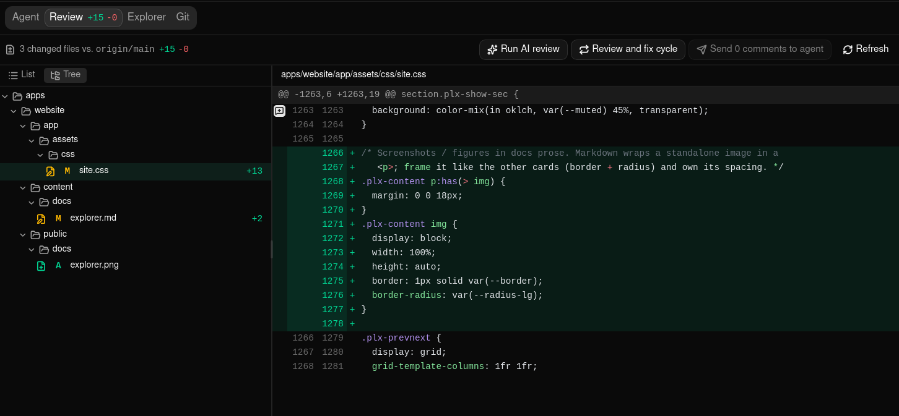
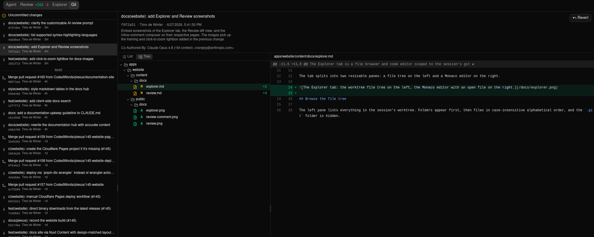
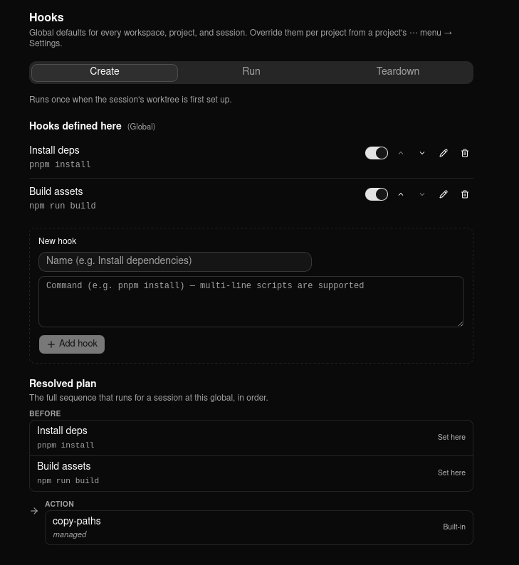

<div align="center">

# Plexus

### Orchestrate your coding agents

Plexus is your control plane for coding CLIs like [Claude Code](https://claude.com/claude-code) — launch,
monitor, and coordinate agents across every project and branch from one fast desktop app.

**Local-first · early access** &nbsp;·&nbsp; Windows · Linux · macOS · free to use

[**Download**](https://github.com/CodedWords/plexus-releases/releases/latest) &nbsp;·&nbsp; [**Documentation**](https://runplexus.com/docs)

</div>



## Download

Plexus is in **early access**. It's a native desktop app for **Windows, macOS, and Linux** — free to use.

→ **[Get the latest release](https://github.com/CodedWords/plexus-releases/releases/latest)** &nbsp;·&nbsp; **[Read the docs](https://runplexus.com/docs)**

## Everything your agents are doing, in one place

Plexus turns a sprawl of terminal tabs into a single, observable control plane.

- **Sessions as worktrees** — every session is its own git worktree running an agent: isolated, parallel, and disposable. Spin up as many as you need.
- **Live observability** — status, logs, diffs, and results for everything in flight, at a glance. Know which agents are working, waiting, or idle.
- **Review & ship** — inspect diffs and run the review-and-fix cycle, with optional AI to draft commits, untangle conflicts, and summarize PRs. Then rebase, squash, merge, or open a PR without leaving the app.
- **One global dashboard** — all projects and sessions in a single view. Sort by activity, jump straight to anything that needs your input.
- **Keyboard-driven** — a command palette, shortcuts for every action, and a dense, terminal-adjacent UI that stays out of your way.
- **Native & local-first** — a fast, lightweight [Tauri](https://tauri.app) app that runs on your machine. Your code and keys never leave it.

> ### No API keys. Just sign in.
>
> Unlike most agent tooling, Plexus is subscription-driven. Connect your account once and every
> session is ready to go — no per-token API keys to provision, rotate, or leak, and no surprise
> usage bills. Your plan, your agents.

## From repo to merged PR without leaving the app

1. **Add a repository** — point Plexus at a local repo. It becomes a project under your workspace — no config, no daemon.
2. **Spin up sessions** — each session creates a git worktree and launches a Claude Code agent on its own branch. Run several at once.
3. **Review, then merge** — watch the diff land, run the review-and-fix loop, and rebase, squash, or open a PR — all from one window.

## A full git client — with AI when you want it

Plexus speaks worktrees natively and handles the whole workflow. Switch AI on and it drafts your
commits, untangles conflicts, and summarizes PRs — all subscription-driven, and entirely optional.
Turn it off and you still have a fast, complete git client.

- **AI commit messages** — generated from the actual diff: conventional, scoped, and accurate.
- **AI conflict resolution** — Plexus proposes a merge for each conflict; you review and approve.
- **PR summaries** — a clear, reviewer-ready description written from your changes.

Plus the basics, no AI required: **Rebase · Squash · Merge · Create PR** (GitHub).



## Automate every session with hooks

Run your own shell commands around a worktree's lifecycle — setup, run, and teardown. Install
dependencies when a session's worktree is created, prep the environment before the agent runs, and
clean up when it's removed. Edit them in `.plexus/hooks.json`, or set them up visually in
**Settings → Hooks** — and Plexus handles the rest.

```json
{
  "create": "pnpm install",
  "run": "cp .env.example .env",
  "teardown": "docker compose down"
}
```

Hooks compose at three levels — **global, workspace, and project** — so shared setup lives in one
place and each repo can override it. Prefer clicking? Set up every hook from the UI — no JSON required.



---

<div align="center">

Agent orchestration for your coding CLIs. A fast, local-first desktop app that stays out of your way.

[Download](https://github.com/CodedWords/plexus-releases/releases/latest) &nbsp;·&nbsp; [Documentation](https://runplexus.com/docs) &nbsp;·&nbsp; [GitHub releases](https://github.com/CodedWords/plexus-releases/releases)

© 2026 Plexus — a [CodedWords](https://www.codedwords.com/) product

</div>
